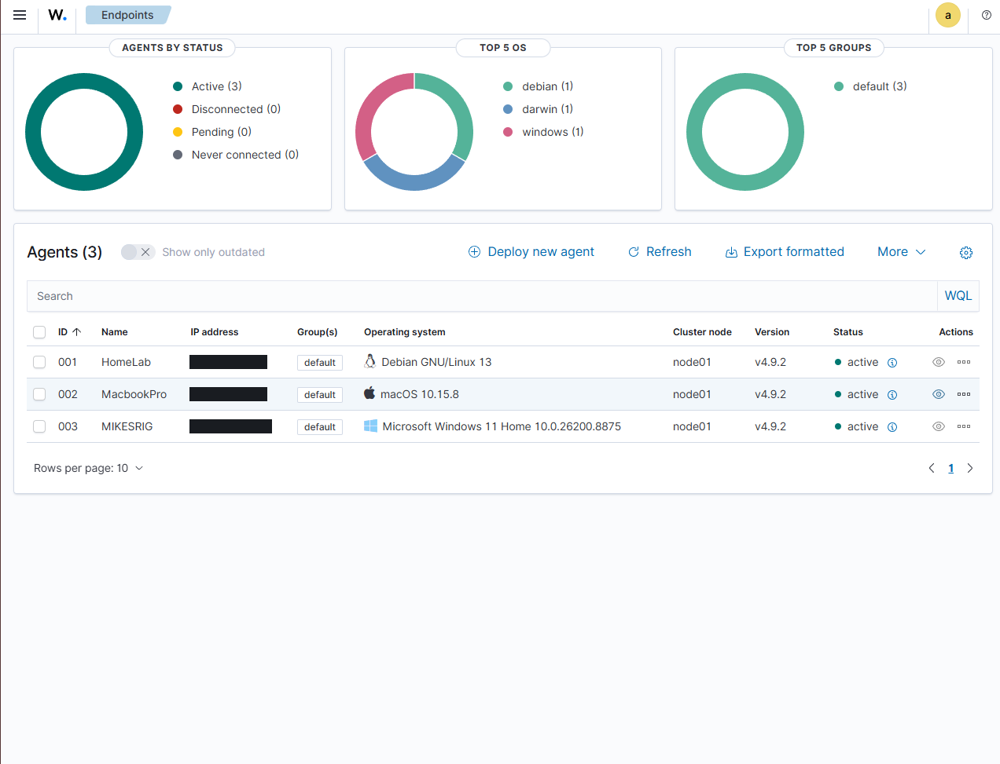
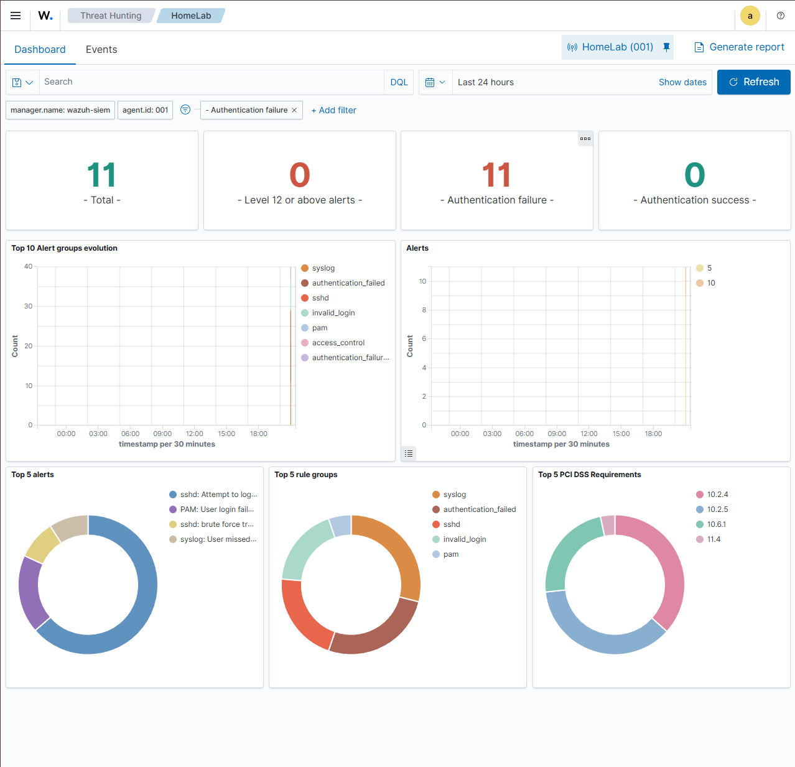
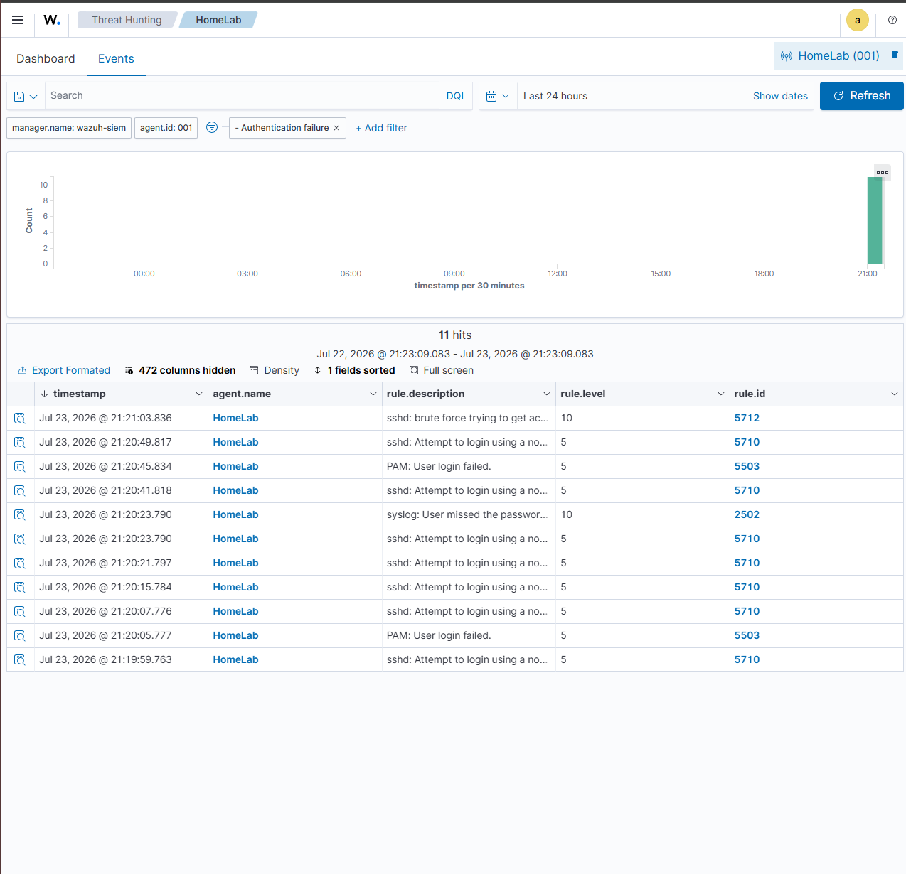
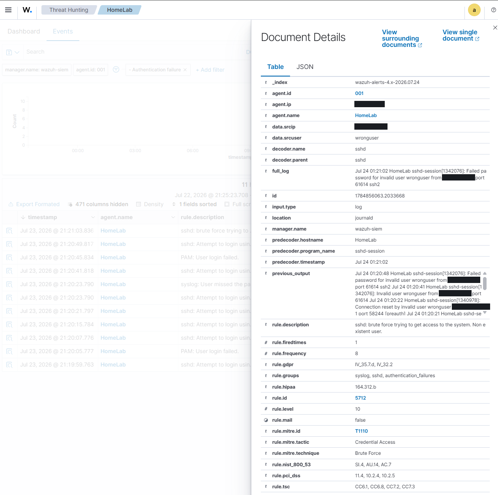

# SOC Home Lab — Multi-OS SIEM with Wazuh

> Built a functioning Security Operations Center home lab: a single-node **Wazuh SIEM** monitoring **three endpoints across three operating systems**, validated end-to-end by simulating an SSH brute-force attack and confirming detection, correlation, and alerting.

**Stack:** Wazuh 4.9 · Ubuntu Server 24.04 · VirtualBox · Tailscale · Debian · macOS · Windows

---

## Summary

I built and validated a centralized SIEM deployment for my home lab. A single-node Wazuh stack (manager, indexer, dashboard) collects and correlates security telemetry from three monitored endpoints running Linux, macOS, and Windows.

To prove the detection pipeline worked end to end, I simulated an **SSH brute-force attack** against the Linux server. The SIEM captured every failed authentication, correlated them into a single brute-force alert within roughly a minute, and automatically mapped the detection to **MITRE ATT&CK T1110** plus PCI DSS, NIST 800-53, and HIPAA controls.

The entire lab runs over a private mesh VPN with **no ports exposed to the public internet**.



*Three agents reporting Active to the manager — Debian, macOS, and Windows.*

---

## Objectives

- Stand up a centralized SIEM to collect and correlate security events from multiple hosts.
- Monitor a heterogeneous fleet (Linux, macOS, Windows) from a single manager.
- Prove the detection pipeline works by generating a real attack signature and confirming the alert.
- Map detections to industry frameworks (MITRE ATT&CK, PCI DSS, NIST 800-53).
- Keep the deployment secure — no public exposure — and document it as a repeatable build.

---

## Architecture

| Component | Role | Platform |
| :-- | :-- | :-- |
| **wazuh-siem** | Wazuh manager + indexer + dashboard (all-in-one) | Ubuntu Server 24.04 LTS, VM in VirtualBox |
| **Linux server** | Monitored endpoint (production media/services host) | Debian 13 |
| **MacBook Pro** | Monitored endpoint | macOS |
| **Workstation** | Monitored endpoint + VM host | Windows 11 |

**Connectivity.** All hosts communicate over a **Tailscale mesh VPN**. Agents enroll against the manager's stable private mesh IP rather than a DHCP-assigned LAN address, so the pipeline survives lease changes. No SSH or management ports are exposed to the public internet.

**Resource footprint.** The SIEM runs in an isolated VM (8 GB RAM / 4 vCPU / 100 GB disk) so the security workload is contained and can't interfere with the host machine — and so it can be snapshotted and migrated to dedicated hardware later.

---

## Build steps

1. **Provisioned the SIEM host.** Created an Ubuntu Server 24.04 VM with a **bridged** network adapter so it sits as a first-class peer on the LAN (NAT would have prevented inbound agent connections). Expanded the LVM root volume to use the full disk — Ubuntu's installer defaults to allocating only half.
2. **Installed Wazuh.** Deployed the all-in-one stack (manager, indexer, dashboard) via the official installation assistant. Secured the generated admin credentials.
3. **Joined the mesh network.** Installed Tailscale on the VM so every agent can reach the manager at a stable private address.
4. **Enrolled agents** on three hosts, each configured to start automatically at boot:
   - **Debian** — native `.deb` package, running as a systemd service
   - **macOS** — Intel `.pkg`, running as a LaunchDaemon
   - **Windows** — MSI, running as a Windows service
5. **Verified telemetry.** Confirmed all three agents reporting **Active**, each streaming authentication events, system logs, and file-integrity data to the manager.

---

## Detection test: SSH brute-force

To validate the pipeline, I simulated a brute-force attack — repeated failed SSH logins using an invalid username against the Debian server — then observed the SIEM's response.

### Result

- **11 authentication-failure events** captured; **0 successful logins**.
- Individual failures logged as **Rule 5710** — *attempt to log in using a non-existent user* (level 5).
- Once failures crossed the correlation threshold, Wazuh escalated to **Rule 5712 — "SSHD brute force trying to get access"** (level 10).
- **Time from first failed login to correlated brute-force alert: ~64 seconds.**



*Threat Hunting dashboard — 11 authentication failures, zero successes, with brute-force appearing in the top alerts breakdown.*

### Event breakdown

| Rule ID | Description | Level | Count |
| :-- | :-- | :-- | :-- |
| 5710 | sshd: attempt to login using a non-existent user | 5 | 7 |
| 5503 | PAM: user login failed | 5 | 2 |
| 2502 | syslog: user missed the password | 10 | 1 |
| **5712** | **sshd: brute force trying to get access** | **10** | **1** |



*Raw event stream — individual failures (5710) escalating into the correlated brute-force detection (5712) at the top.*

### Framework mapping

Wazuh automatically enriched the alert with framework and compliance context — the vocabulary used to communicate findings in a real SOC:

| Framework | Mapping |
| :-- | :-- |
| **MITRE ATT&CK** | **T1110** — Credential Access / Brute Force |
| **PCI DSS** | 10.2.4, 10.2.5, 11.4 |
| **NIST 800-53** | SI.4, AU.14, AC.7 |
| **HIPAA** | 164.312.b |
| **GDPR** | IV_35.7.d, IV_32.2 |



*Full alert detail — decoder, raw log, correlated prior events, MITRE technique, and compliance mappings. Network addresses redacted.*

---

## What I learned

- **SIEM fundamentals** — log collection, normalization, rule-based correlation, and the crucial difference between an individual *event* and a correlated *alert*.
- **Multi-OS agent deployment** — enrolling and troubleshooting agents across Linux, macOS, and Windows, including service persistence and platform-specific obstacles (macOS system-extension approval; Windows silent installs failing without elevation).
- **Detection engineering basics** — how threshold-based correlation turns noise into signal.
- **Framework mapping** — connecting a raw detection to MITRE ATT&CK and compliance controls.
- **Secure remote architecture** — using a mesh VPN to manage and monitor infrastructure without exposing anything to the public internet.

---

## Next steps

- [ ] **Remediation (detect → respond → verify):** deploy fail2ban on the Linux host to auto-block brute-force sources, then re-run the attack to confirm the block and capture the before/after.
- [ ] **Expand coverage:** add a dedicated attacker host (Kali) and run a broader technique set — port scanning, credential stuffing.
- [ ] **Custom detections:** author custom Wazuh rules and file-integrity monitoring policies tuned to this environment.
- [ ] **Migrate to always-on hardware** so the SIEM runs 24/7 independent of the workstation.

---

## Repository structure

```
.
├── README.md
└── screenshots/
    ├── 01-endpoints-3-agents-redacted.png
    ├── 02-threat-hunting-dashboard.png
    ├── 03-events-rule-ids.png
    └── 04-alert-detail-rule5712-redacted.png
```

---

*All network addresses in the screenshots above have been redacted. This lab runs on personally owned hardware; all simulated attacks were conducted against my own systems.*
